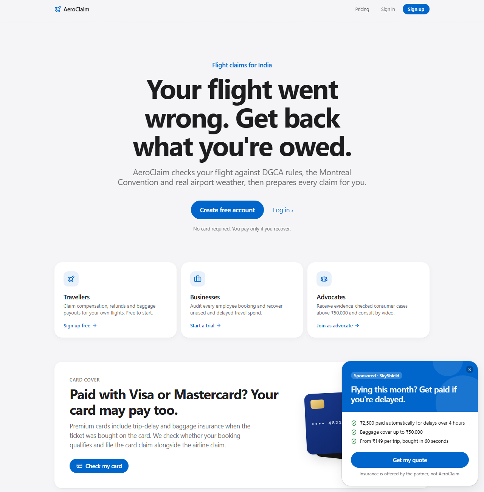
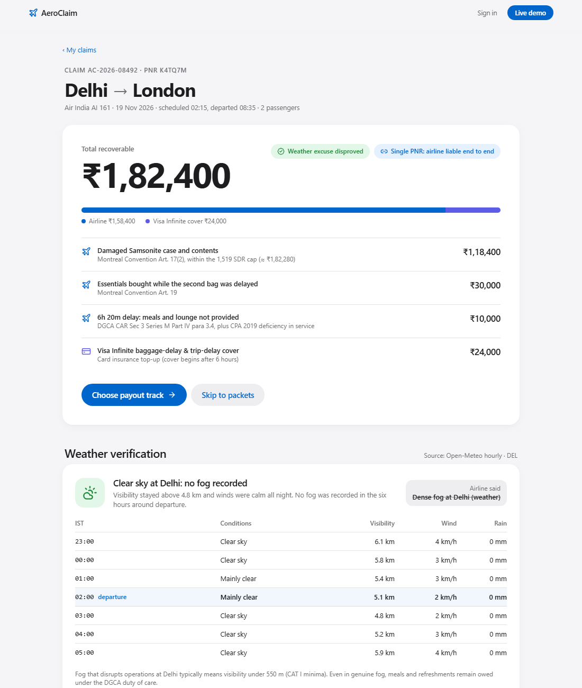
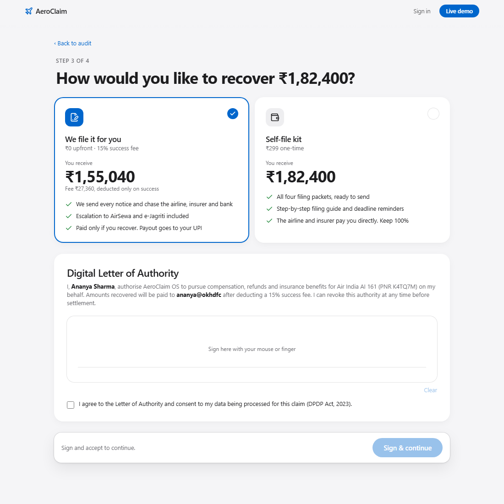
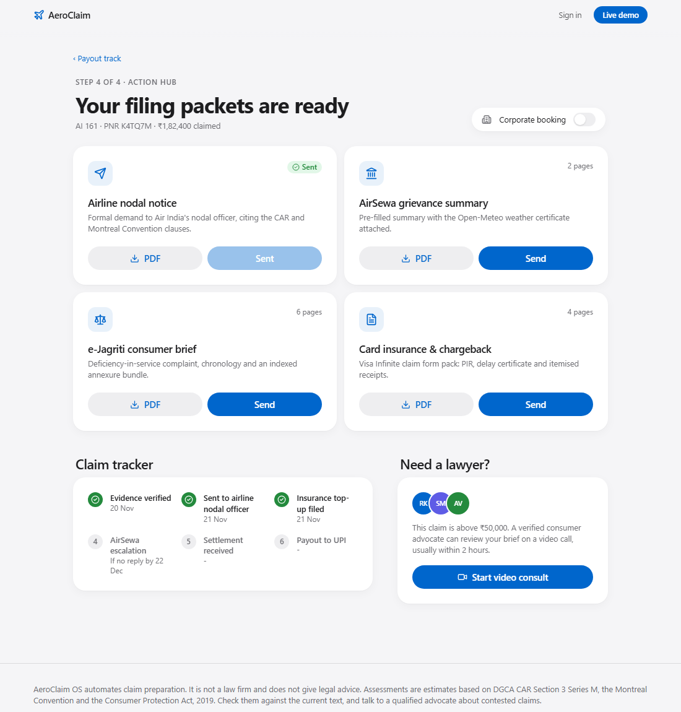
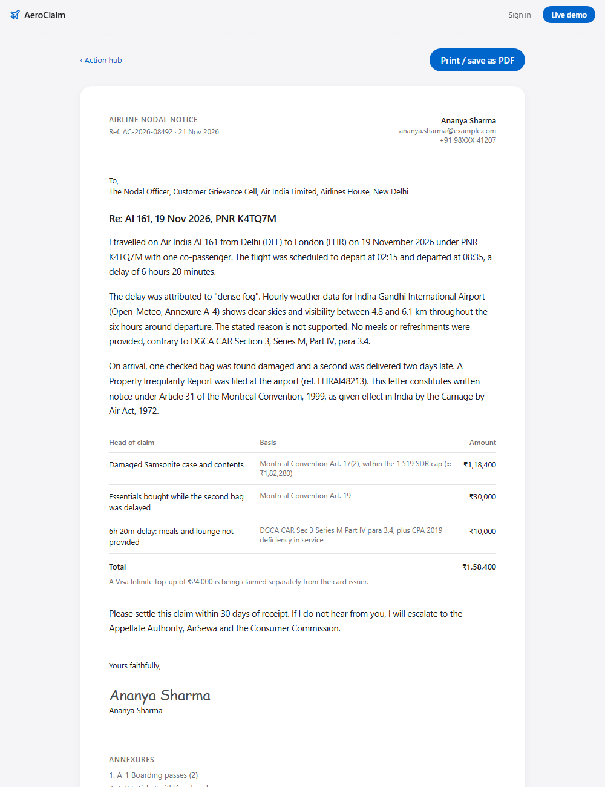
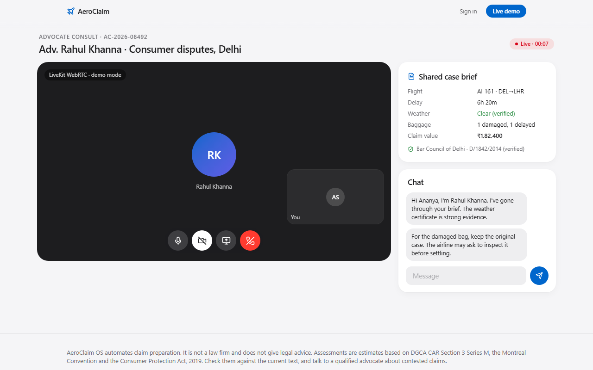
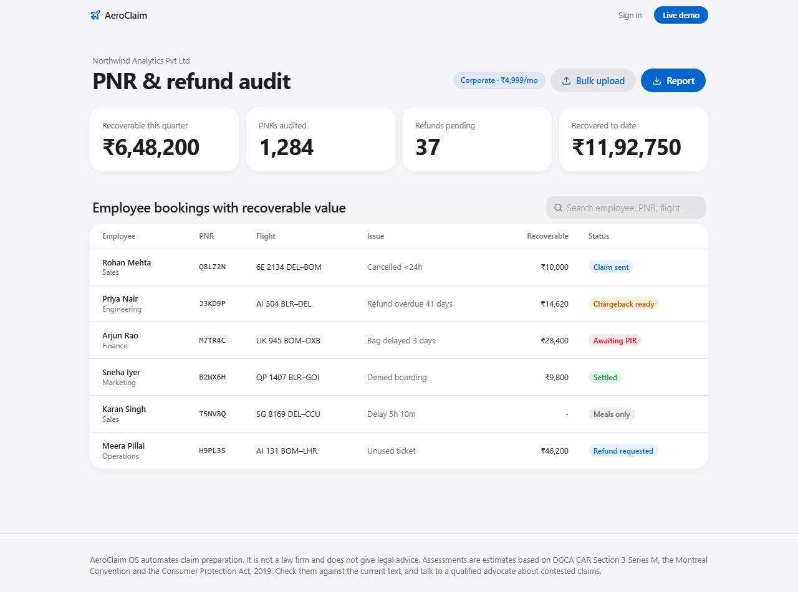
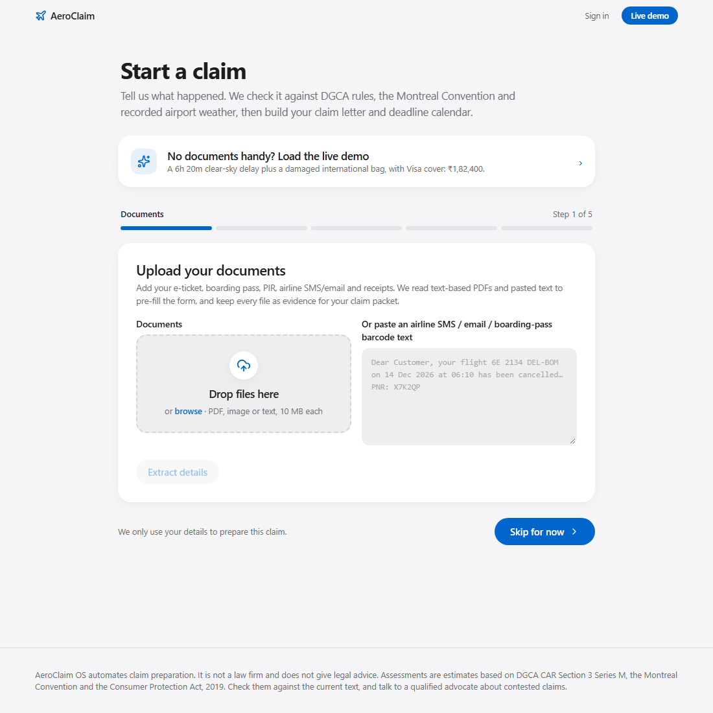
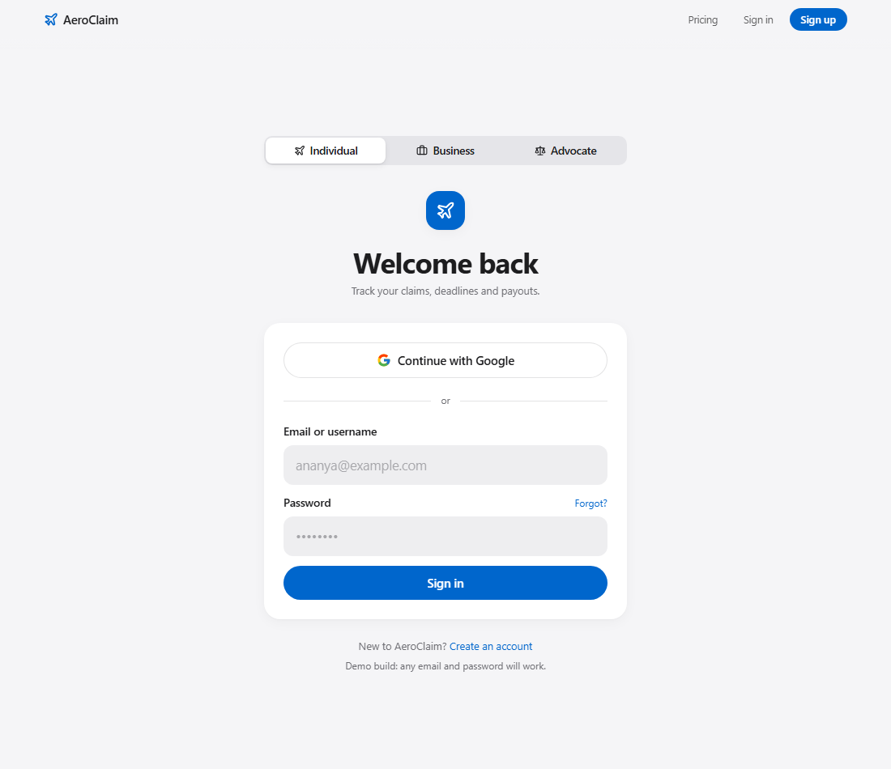
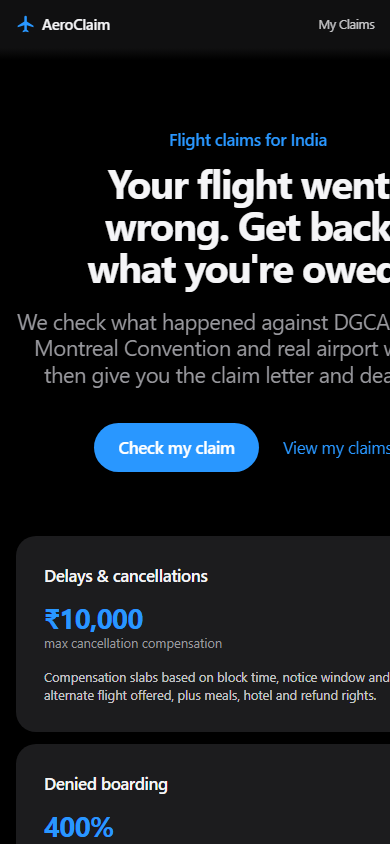

<p align="center">
  
</p>

<h1 align="center">AeroClaim OS</h1>

<p align="center">
  Flight delay, cancellation, baggage and refund claims for India, worked out properly.
  <br>
  DGCA rules, the Montreal Convention, real airport weather, and every deadline that can sink a claim.
</p>

<p align="center">
  <a href="#run-it-locally">Run locally</a> ·
  <a href="#deploying-to-vercel">Deploy</a> ·
  <a href="#how-the-rules-work">How the rules work</a> ·
  <a href="#contributing">Contributing</a>
</p>

---

## Why this exists

If IndiGo cancels your 6 a.m. Delhi–Mumbai flight with four hours' notice, you are owed up to ₹10,000 under DGCA rules. Almost nobody claims it. The rules are buried in a PDF called *CAR Section 3, Series M, Part IV*. The airline's SMS says "due to weather", and you have no way of knowing if that's true. And if it was your bag that got damaged, you had **7 days** to complain in writing, which you probably found out on day 9.

AeroClaim takes what you already have (the e-ticket, the boarding pass, the airline's SMS) and tells you three things:

1. **What you're owed**, with the exact rule behind every rupee.
2. **Whether the airline's excuse holds up**, checked against hourly weather at both airports.
3. **What you need to do, and by when**, as a ready-to-send letter and a calendar file with every legal deadline.

## What it looks like

The whole journey runs on sample data from **Live demo** in the top bar: a 6h 20m Delhi–London delay blamed on fog, plus a damaged and a delayed bag, worth ₹1,82,400.

| Audit | Payout track |
| --- | --- |
|  |  |

| Filing packets | Claim letter |
| --- | --- |
|  |  |

| Advocate consult | Corporate PNR audit |
| --- | --- |
|  |  |

| Step-by-step claim form | Sign in | Mobile |
| --- | --- | --- |
|  |  |  |

## A real example

> 6E 2134, DEL → BOM, 10 Nov 2026, 06:10. Cancelled; passenger told 4 hours before. Airline says: weather. Basic fare + fuel charge: ₹5,200.

| Step | Result |
| --- | --- |
| Block time | 2h 15m, which puts it in the ₹10,000 slab |
| Notice | Under 24 hours, with no alternate flight within 2 hours, so compensation is due |
| Cap | Compensation can't exceed basic fare + fuel, so **₹5,200** |
| Weather at DEL 03:00–09:00 | Clear, visibility 5.7–7.1 km, gusts under 10 km/h |
| Weather at BOM 05:25–11:25 | Clear, visibility 13.8–15.4 km |
| Verdict | The weather excuse isn't supported by the data. Risk of an "extraordinary circumstances" defence: **low** |
| Output | Claim letter citing CAR para 3.2 & 3.6, a chronology, an annexure index, and an `.ics` with the AirSewa follow-up and the 2-year e-Jagriti limit |

## What's covered

**Cancellations.** The ₹5,000 / ₹7,500 / ₹10,000 slabs by block time, the 2-week and 24-hour notice windows, the "alternate within 2 hours" exemption, and the cap at basic fare plus fuel charge.

**Denied boarding.** 200% of basic fare + fuel (capped at ₹10,000) if you're re-accommodated within 24 hours. 400% (capped at ₹20,000) after that, or if no alternate flight is offered. Nothing if the alternate left within an hour.

**Delays.** DGCA doesn't pay cash for delays, but it does require meals once you pass a threshold (2h, 3h or 4h depending on block time). It also requires a refund or alternate flight past 6 hours, and a hotel past 24 hours (or 6 hours for departures between 20:00 and 03:00). The app tells you which of these you were owed and didn't get.

**Baggage.** The Montreal Convention limit of 1,519 SDR (revised December 2024), the Article 31 written-notice windows (7 days for damage, 21 days for delay), the 21-day "deemed lost" rule, and the 2-year limitation. If you left the airport without a PIR, it tells you so and drafts the written notice.

**Refunds.** Under CAR Part II, card payments are due within 7 days and agent/OTA bookings within 30 working days. Statutory taxes are refundable even on non-refundable fares. Once the airline misses its deadline, the claim flags a card chargeback with the typical 120-day window.

**Connections.** A missed connection on a single PNR is the airline's problem. On separate tickets it isn't, and the app points you at your travel or card insurance instead.

## How the rules work

Rules live in plain TypeScript, not a black box. Every finding carries the clause it came from.

```
src/lib/rules/
├── pack.ts     the RulePack interface
├── india.ts    DGCA CAR Part II & IV, Montreal Convention, CPA 2019
└── index.ts    picks the pack for a claim
```

A rule pack takes the claim, the weather report and the uploaded documents, and returns findings, duty-of-care items, deadlines, an evidence checklist and an estimate. Adding EU261 or the UK261 regime means writing a new pack and registering it in `index.ts`. Intake, packets and the UI don't change.

```ts
export interface RulePack {
  id: string;
  name: string;
  appliesTo(input: ClaimInput): boolean;
  evaluate(input: ClaimInput, ctx: RuleContext): Assessment;
}
```

The engine is pure, with no I/O, which is why it's covered by unit tests. Each slab, cap and deadline above has a test in `src/lib/__tests__/rules.test.ts`.

### Weather

`src/lib/weather.ts` pulls hourly data from [Open-Meteo](https://open-meteo.com) for both airports, three hours either side of the scheduled times. It uses the forecast API for recent and upcoming flights, the historical-forecast API back to 2022, and the ERA5 archive before that. Each hour is classified:

| Severe | Marginal |
| --- | --- |
| Thunderstorm, heavy rain/snow | Fog, moderate rain/snow |
| Visibility under 550 m (CAT I minima) | Visibility under 1,500 m |
| Gusts ≥ 65 km/h | Gusts ≥ 45 km/h |

This is modelled data, not METARs, and it can't see en-route weather or knock-on delays from the aircraft's previous rotation. The app says so on the report. It's good enough to catch the common case: "fog" at Delhi on a clear morning.

### Document parsing

`src/lib/parser.ts` reads text-layer PDFs, pasted SMS/email text, and raw IATA BCBP boarding-pass barcode strings (Resolution 792, mandatory fields). It pulls out the PNR, flight number, route, date, PIR reference and the airline's stated reason, and classifies each file (boarding pass, PIR, airline notice, receipt, and so on) so the evidence checklist fills itself in.

## Stack

- **Next.js 16** (App Router, Cache Components, Turbopack), **React 19**, **TypeScript**
- **Tailwind CSS v4**, with a hand-rolled design system in `globals.css`: system font, size-specific tracking, light/dark, and support for reduced motion, reduced transparency and increased contrast
- **libSQL**: a local SQLite file in development, [Turso](https://turso.tech) in production
- **Vercel Blob** (private store) for evidence files, uploaded straight from the browser
- **unpdf** for PDF text extraction
- **Vitest** for the rule engine, parser and date maths

## Run it locally

You need Node 20.9 or newer.

```bash
git clone https://github.com/hashmicode-lead/aeroclaim.git
cd aeroclaim
npm install
npm run dev
```

Open <http://localhost:3000>. No accounts or keys are needed. Claims go into `./data/aeroclaim.db` and uploads into `./data/uploads/`, both gitignored.

```bash
npm test           # 32 tests: rules, parser, weather, time
npm run typecheck
npm run lint
npm run build
```

## Deploying to Vercel

Vercel functions have a read-only filesystem, so production uses Turso for the database and Vercel Blob for files. The browser uploads evidence directly to Blob with a short-lived token, which gets around the 4.5 MB request limit. Files stay private and are streamed back through `/api/documents/[id]`.

1. **Import** the repo on Vercel. The defaults are fine.
2. **Storage → Blob**: create a store with access set to **Private** and connect it. This sets `BLOB_READ_WRITE_TOKEN`.
3. **Storage → Turso** (Marketplace): create and connect a database. This sets `TURSO_DATABASE_URL` and `TURSO_AUTH_TOKEN`. Tables are created on the first request.
4. **Redeploy** so the build picks up the variables.

It also deploys with no storage connected at all: claims and uploads then go to `/tmp`, which Vercel clears between cold starts. That's fine for a demo. Connect Turso and Blob for anything real. See `.env.example`.

## Project layout

```
src/
├── app/
│   ├── page.tsx                    landing
│   ├── claims/new/                 intake form
│   ├── claims/[id]/                assessment report
│   ├── claims/[id]/packet/         printable claim letter
│   └── api/
│       ├── claims/                 create claim (validate → weather → rules → store)
│       ├── claims/[id]/calendar    .ics export
│       ├── claims/[id]/recheck     re-run weather + rules
│       ├── parse/                  auto-fill from documents
│       ├── uploads/                Blob client-upload tokens
│       └── documents/[id]          stream an evidence file
├── components/                     ClaimForm, buttons, badges
└── lib/
    ├── rules/                      jurisdiction rule packs
    ├── weather.ts  parser.ts  packet.ts  ics.ts
    ├── db.ts  storage.ts           libSQL + Blob/local storage
    └── validate.ts  time.ts  airports.ts
```

## Roadmap

Phase 1 (this repo) covers intake, the rule engine, weather checks, deadlines and the claim packet. Next up:

- [ ] Insurance top-up and card chargeback packets from the same evidence bundle
- [ ] AirSewa and e-Jagriti complaint drafts
- [ ] Settlement checker that warns before you accept a ₹2,000 voucher and waive your rights
- [ ] Email and WhatsApp reminders before deadlines (Vercel Cron)
- [ ] Barcode scanning and OCR for photos of boarding passes, PIRs and receipts
- [ ] Flight-status API to confirm actual delay minutes and whether other flights operated
- [ ] Live IMF SDR→INR rate (currently a fixed ₹120 estimate in `rules/india.ts`)
- [ ] Accounts, consent and one-click data deletion (DPDP Act)
- [ ] Payments, e-signed Letter of Authority, advocate consultations, corporate dashboard

## Contributing

1. Branch off `dev`, not `master`: `git checkout dev && git checkout -b feature/short-name`
2. Keep the rule engine pure. If a rule needs data from the outside world, fetch it in the route and pass it in through `RuleContext`.
3. Every new rule gets a test, with the clause number in the finding's `basis` field.
4. Run `npm test && npm run typecheck && npm run lint` before opening a PR into `dev`.

`master` is what's deployed. `dev` is where work lands first.

## A note on the law

AeroClaim is a claim-preparation tool, not a law firm, and nothing it produces is legal advice. The thresholds here come from the published DGCA CARs, the Carriage by Air Act, 1972 and the Consumer Protection Act, 2019. Regulations get amended, so if you're relying on a number, check it against the current text. For contested or high-value claims, talk to a consumer-rights advocate.
